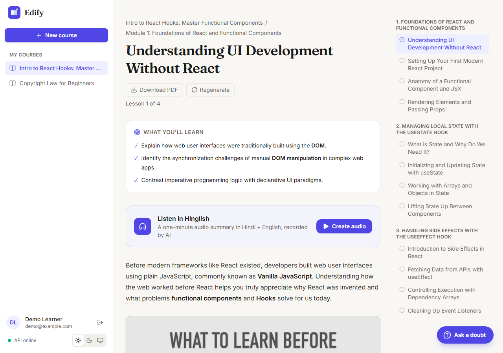
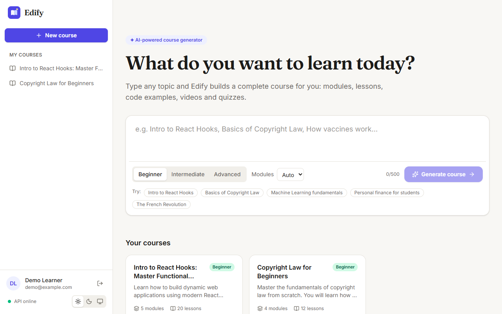
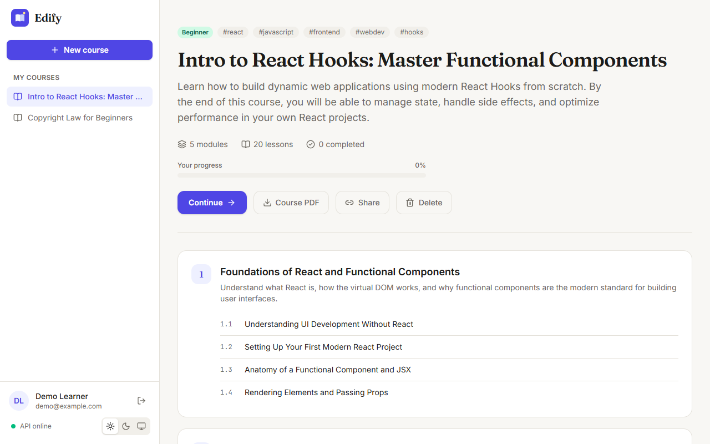
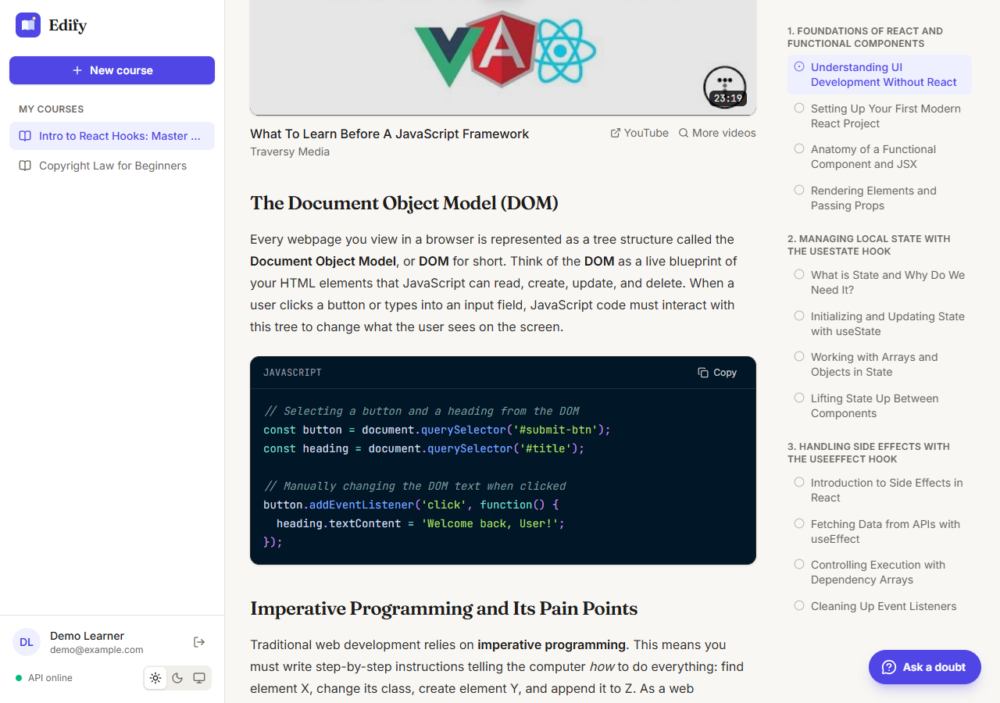
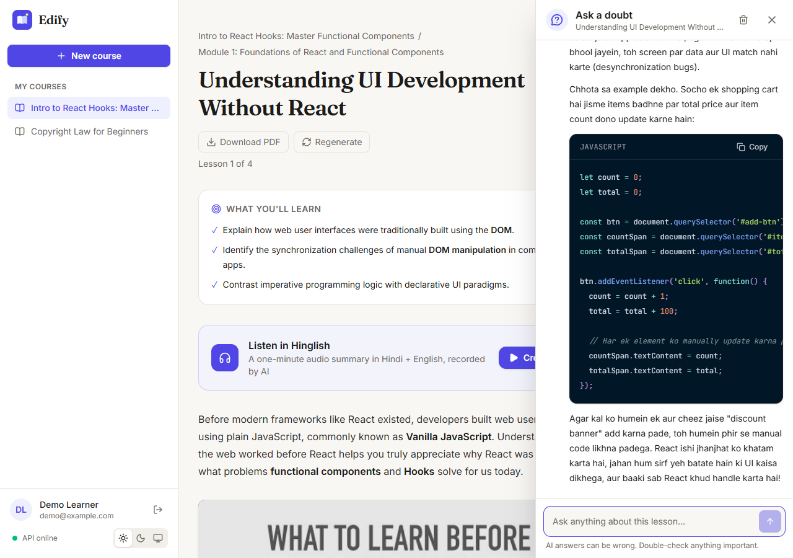
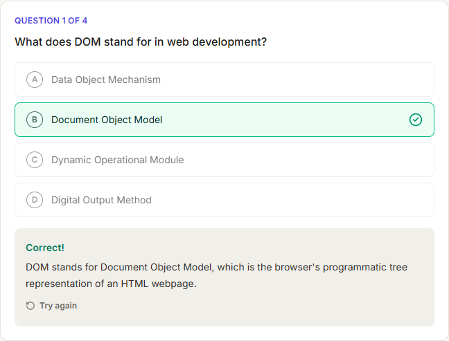
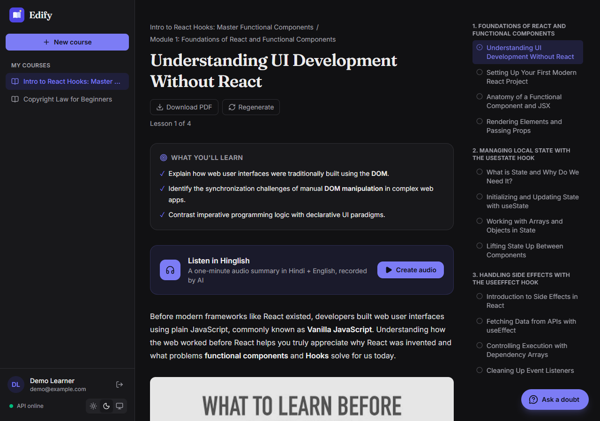
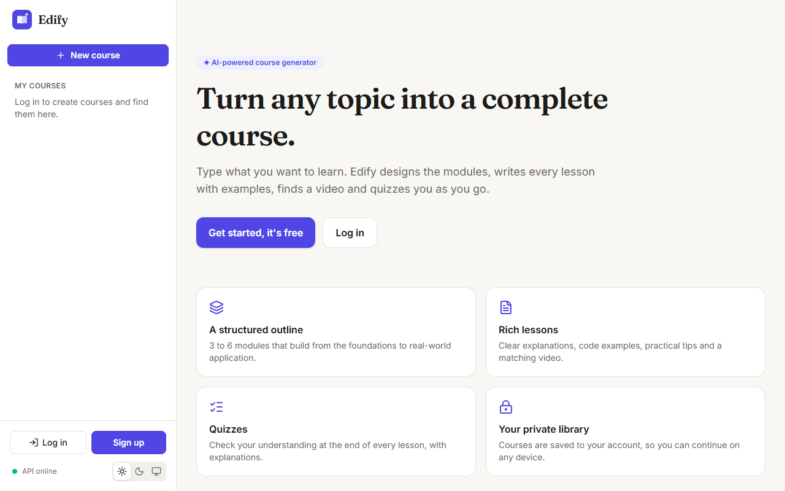
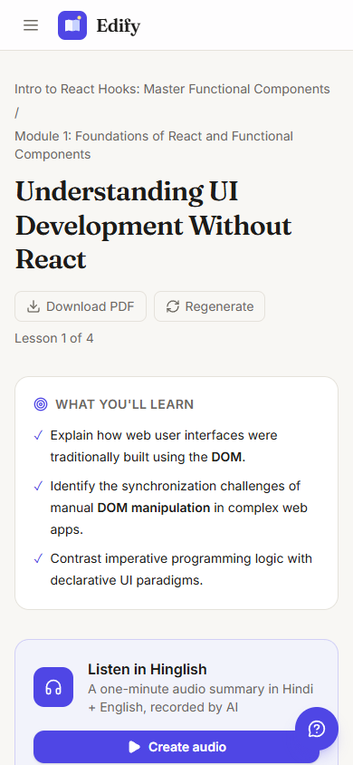

# Edify: Text-to-Learn

> Turn any topic into a structured, multi-module online course with AI.

[](https://github.com/shreyashtrivedi/Edify/actions/workflows/ci.yml)
**Live demo: [edify-gold.vercel.app](https://edify-gold.vercel.app)**

Type a topic like *"Intro to React Hooks"* or *"Basics of Copyright Law"* and Edify builds a complete
course: 3–6 modules of 3–5 lessons each. Every lesson has learning objectives, clear explanations,
code examples where they help, a matching YouTube video, a quiz with explanations and suggested
readings. Lessons can be downloaded as PDF, listened to in Hinglish, and questioned with an AI tutor.



> The API runs on Render's free plan, which sleeps after 15 idle minutes. If you're the first visitor
> in a while, the site tells you it's waking the server up (up to a minute); after that it's quick.

## Features

**From prompt to course**
- **Course outline in seconds:** title, description, tags and 3–6 modules of 3–5 lessons, generated
  from one prompt, with a level (beginner / intermediate / advanced) and an optional module count.
- **Rich lessons, written on first open:** objectives, headings, paragraphs, code blocks with syntax
  highlighting, tips and warnings, lists, 4–5 multiple-choice questions with explanations, and
  suggested readings. Saved once, instant afterwards; *Regenerate* writes a fresh version.
- **Real videos:** the AI suggests a search; the server picks a real, embeddable YouTube video and
  caches it. The video loads only when you press play.

**Learning tools**
- **Hinglish audio:** a one-minute summary of the lesson in Hindi + English, recorded with Gemini
  text-to-speech and stored, so it's generated only once.
- **Ask a doubt:** a tutor chat on every lesson that knows the lesson's content, streams its answer
  word by word, replies in the learner's language (Hinglish in, Hinglish out) and stays on topic.
- **PDF export:** a single lesson, or the whole course with a cover, clickable contents, bookmarks
  and an answer key. Real text (selectable, searchable), not screenshots.
- **Progress tracking:** completed lessons and saved quiz answers, graded on the server, with
  progress bars per course.

**Accounts and sharing**
- **Login with Auth0** (email or Google). Each learner has a private course library.
- **Share links:** a read-only public link to a course (no login needed to read), which can be turned
  off at any time. Logged-in visitors can save a copy to their own library.

**Quality**
- Light, dark and system themes, readable to WCAG AA contrast in both.
- Accessible (an axe audit of every page in both themes found 0 violations) and responsive down to
  phone size.
- 142 automated tests, CI on every push and pull request, and automatic deploys from `main`.

## Screenshots

| | |
|---|---|
|  |  |
| **Generate a course** from any topic, at your level | **The course outline**, with progress, PDF export and sharing |
|  |  |
| **Lessons** with a matched video and highlighted code | **Ask a doubt**: the tutor answers in Hinglish, grounded in the lesson |
|  |  |
| **Quizzes** graded on the server, with explanations | **Dark mode** |
|  |  |
| **Landing page** for new visitors | **On a phone** |

## How it works

```
 "Intro to React Hooks"
        │
        ▼
 1. Outline (one Gemini call, schema-constrained)  →  Course → Modules → Lesson titles, saved
        │
        ▼  the learner opens a lesson
 2. Lesson content (Gemini, JSON mode + zod validation)  →  blocks: text, code, quiz, video query…
        │
        ▼
 3. YouTube Data API turns the video query into a real video (cached)  →  saved with the lesson
        │
        ▼  on demand
 4. Hinglish audio (Gemini script + Gemini TTS → MP3) · tutor chat (streamed) · PDF (in the browser)
```

A few decisions that shaped the code:

- **Two-stage generation.** The outline is cheap and fast; full lessons are written only when someone
  opens them. A 20-lesson course doesn't cost 20 lesson generations up front.
- **Two output strategies for AI JSON.** The small, rigid outline uses Gemini's schema-constrained
  decoding. Large, flexible lessons use JSON mode with a forgiving zod schema that validates and
  repairs, because the big schema made the model misplace fields.
- **AI text is never inserted as HTML.** `**bold**`, `*italic*` and `` `code` `` are parsed into React
  elements, so injected markup in AI output is shown as plain text.
- **Secrets stay on the server.** The YouTube and Gemini keys are only used by the API; everything in
  the browser bundle is public by design.
- **Honest failure modes.** When Gemini is overloaded, the visitor is told exactly that and can try
  again; only unexpected crashes get a generic message.

The full design, with the reasoning and trade-offs behind each part, is in
**[docs/ARCHITECTURE.md](docs/ARCHITECTURE.md)**.

## Tech stack

| Layer | Tech |
|---|---|
| Frontend | React 19, Vite 8, Tailwind CSS v4, React Router v7, axios, @react-pdf/renderer |
| Backend | Node.js 22, Express 5, Mongoose 9, zod 4, helmet, express-rate-limit |
| AI | Google Gemini (`@google/genai`): text, structured JSON, streaming and text-to-speech |
| Video | YouTube Data API v3 |
| Auth | Auth0 (Authorization Code + PKCE, refresh tokens; JWTs verified by the API) |
| Database | MongoDB Atlas |
| Testing | vitest, supertest, mongodb-memory-server |
| Hosting & CI | Vercel (frontend), Render (API), GitHub Actions |

## Project structure

```
Edify/
├── client/          React app: pages, components, hooks, PDF export (deployed to Vercel)
├── server/          Express API: routes → controllers → services → models (deployed to Render)
│   └── tests/       API tests against an in-memory MongoDB, with Gemini mocked
├── docs/            ARCHITECTURE.md (design, data model, API reference) and screenshots
├── render.yaml      Render Blueprint: how the API is hosted
└── .github/         CI workflow
```

## Run it locally

Requirements: **Node.js 22**.

```bash
# 1. Install everything (root, server, client)
npm run install:all

# 2. Configure the API and the app
cp server/.env.example server/.env          # add GEMINI_API_KEY, YOUTUBE_API_KEY, AUTH0_DOMAIN, AUTH0_AUDIENCE
cp client/.env.example client/.env.local    # add the VITE_AUTH0_* values
npm run check:ai --prefix server            # verifies the Gemini key + model work
npm run check:youtube --prefix server       # verifies the YouTube key
npm run check:tts --prefix server           # records a test Hinglish sentence (Gemini TTS)

# 3. Start API (http://localhost:5000) and app (http://localhost:5173) together
npm run dev
```

Leave `MONGO_URI` empty for local development and the API uses a temporary in-memory MongoDB.
No Gemini key yet? Set `AI_MOCK=true` in `server/.env` to use realistic sample content instead.

### Auth0 setup (free)

1. **Applications → Applications → Create Application** → *Single Page Web Applications*. In its
   Settings, set Allowed Callback URLs, Allowed Logout URLs and Allowed Web Origins to
   `http://localhost:5173` (add your Vercel URL later, comma-separated).
2. **Applications → APIs → Create API** with Identifier `https://edify-api` (RS256). In its
   Settings, enable **Allow Offline Access** (refresh tokens).
3. In the API's **Application Access** tab, authorize the Edify application for **user access**.
4. Copy the app's Domain + Client ID and the API Identifier into the two `.env` files.

## Deploy

Everything runs on free plans: the API on **Render**, the app on **Vercel**, the database on
**MongoDB Atlas**. The reasoning behind each setting is in
[docs/ARCHITECTURE.md → 11. Deployment](docs/ARCHITECTURE.md#11-deployment).

1. **Database:** create a free Atlas cluster and a database user, and allow access from `0.0.0.0/0`
   (Render's free plan has no fixed IP). Copy the connection string and add `edify` after `.net/`.
2. **API:** Render → New → Blueprint → this repo. `render.yaml` sets up the service; Render asks for
   `MONGO_URI`, `GEMINI_API_KEY`, `YOUTUBE_API_KEY`, `AUTH0_DOMAIN`, `AUTH0_AUDIENCE` and `CLIENT_URL`
   (the Vercel address from step 3; update it once you have it).
3. **App:** Vercel → Add New → Project → this repo, Root Directory `client`. Add `VITE_API_URL` (the
   Render address) and the three `VITE_AUTH0_*` values. If one is missing, the build stops and names it.
4. **Auth0:** add the Vercel address to Allowed Callback URLs, Allowed Logout URLs and Allowed Web Origins.

After that, every merge into `main` deploys itself: Render once CI passes, Vercel straight away.

## Scripts

| Command (from root) | What it does |
|---|---|
| `npm run dev` | runs server + client with live reload |
| `npm test` | server tests (vitest + in-memory MongoDB) and client tests (vitest) |
| `npm run lint` | lints server and client |
| `npm run build` | production build of the client |

## Testing and quality

- **109 server tests:** authentication (missing, forged, expired and wrong-audience tokens), data
  isolation between users, AI output validation and retries, error mapping, progress grading, the
  streaming tutor, share links, narration, YouTube selection and caching.
- **33 client tests:** text parsing and formatting, URL builders, theme storage and the server
  wake-up logic (on fake timers).
- **CI** (GitHub Actions) lints, tests and builds both halves on every push and pull request; Render
  only deploys `main` after CI passes.
- Every feature was built on its own branch and merged into `main` with a merge commit; since the
  first deploy, changes go through GitHub pull requests, checked by CI before merging.

## Author

Built by **Shreyash Trivedi** ([@shreyashtrivedi](https://github.com/shreyashtrivedi)).
